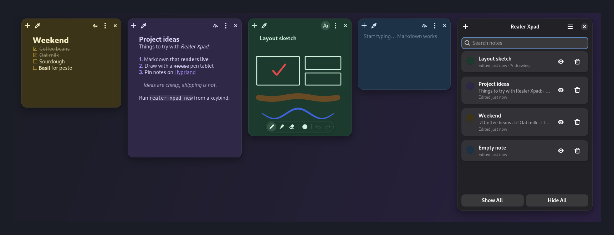

# Realer Xpad

Sticky notes for Linux with **Markdown** and **drawing**, built for Wayland
and Hyprland. Like xpad, but with nicer notes.




## Features

- **Live Markdown**: headings, **bold**, *italic*, ~~strike~~, `code`, code
  blocks, quotes, links, bullet/numbered lists and clickable `- [ ]`
  checkboxes. Styling appears as you type, and a clean read view shows when
  the note isn't focused.
- **Drawing**: pen, highlighter and eraser, six ink colours, three sizes,
  stylus pressure (and the stylus eraser tip), and undo/redo. The default ink
  follows the note's text colour, so drawings stay visible in dark mode.
- Seven note colours with light and dark variants that follow your system
  theme.
- Autosave. Notes are plain `.md` files you can grep and back up.
- Notes manager with search, show/hide and delete (deleted notes go to a
  trash folder).
- Native Wayland (GTK 4 + libadwaita, no Xwayland).
- **Hyprland integration**: notes float, remember their position and size,
  and can be pinned to every workspace.

## Install

Requirements: Python ≥ 3.11, GTK ≥ 4.14, libadwaita ≥ 1.5 and PyGObject.

```sh
# Debian / Ubuntu
sudo apt install python3-gi gir1.2-gtk-4.0 gir1.2-adw-1
# Arch
sudo pacman -S python-gobject gtk4 libadwaita

./install.sh          # adds ~/.local/bin/realer-xpad and a desktop entry
```

Or run it straight from the checkout: `python3 -m realer_xpad`.

### Hyprland

Wayland doesn't let apps place their own windows, so add the rules from
[`extras/hyprland.conf`](extras/hyprland.conf) to your config. Without them,
notes are tiled like normal windows. The file also has an `exec-once` entry
and keybinds:

```ini
windowrule = match:class ^(ch\.giosuel\.RealerXpad)$, float on
windowrule = match:class ^(ch\.giosuel\.RealerXpad)$, border_size 0
bind = SUPER, N, exec, realer-xpad new
bind = SUPER SHIFT, N, exec, realer-xpad toggle
```

The new `match:` syntax above is for Hyprland 0.53 and newer. The file also
includes the older form.

Realer Xpad talks to Hyprland's IPC socket to restore each note's position
and size and to pin notes. On other compositors, notes open wherever the
compositor puts them.

## Usage

| | |
|---|---|
| `realer-xpad` | start, or show all open notes |
| `realer-xpad new` | new note |
| `realer-xpad toggle` | hide / show all notes |
| `realer-xpad manager` | notes manager |
| `realer-xpad quit` | save and quit |

### Shortcuts

| Key | Action |
|---|---|
| <kbd>Ctrl</kbd>+<kbd>N</kbd> | new note |
| <kbd>Ctrl</kbd>+<kbd>D</kbd> | toggle draw mode |
| <kbd>Ctrl</kbd>+<kbd>E</kbd> | switch between edit and read view |
| <kbd>Ctrl</kbd>+<kbd>B</kbd> / <kbd>Ctrl</kbd>+<kbd>I</kbd> | bold / italic |
| <kbd>Tab</kbd> / <kbd>Shift</kbd>+<kbd>Tab</kbd> | indent / outdent list item |
| <kbd>Enter</kbd> | continue list (on an empty item: end the list) |
| <kbd>Ctrl</kbd>+<kbd>W</kbd> | close (hide) note |
| <kbd>Esc</kbd> | read view / leave draw mode |
| <kbd>P</kbd> / <kbd>H</kbd> / <kbd>E</kbd> | pen / highlighter / eraser (draw mode) |
| <kbd>Ctrl</kbd>+<kbd>Z</kbd>, <kbd>Ctrl</kbd>+<kbd>Shift</kbd>+<kbd>Z</kbd> | undo / redo |
| <kbd>Ctrl</kbd>+click | open link while editing |

Notes live in `~/.local/share/realer-xpad/` (or `$REALER_XPAD_DATA`).

## Development

```sh
python3 -m venv --system-site-packages .venv && .venv/bin/pip install pytest
.venv/bin/pytest                          # logic tests; UI tests skip without a display
tools/headless.sh .venv/bin/pytest        # everything, in a throwaway headless sway
tools/headless.sh .venv/bin/python tools/screenshot.py docs [--dark]
```

`tools/headless.sh` needs `sway`. It runs a pure-Wayland session without
Xwayland, so the tests also check that the app doesn't depend on X11.

| Module | |
|---|---|
| `markdown.py` | parser → style spans / markers, read-view renderer |
| `md_editor.py` | live-styled edit view + read view |
| `drawing.py` / `canvas.py` | stroke model with undo; GSK-rendered canvas |
| `note_window.py` | the sticky note |
| `manager.py` | notes manager |
| `hypr.py` | Hyprland IPC |
| `store.py` | `.md` + `.json` persistence |

## License

AGPL-3.0. See [LICENSE](LICENSE).
