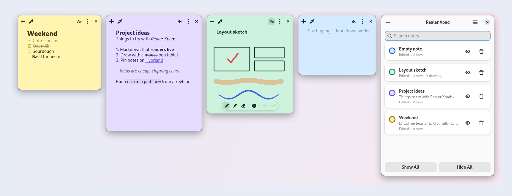

<div align="center">


# Realer Xpad

**Sticky notes for Linux that speak Markdown and let you doodle.**<br>
<sub>🦀 Powered by Rust</sub>

[](https://github.com/giosuel/realer-xpad/actions/workflows/ci.yml)
[](https://github.com/giosuel/realer-xpad/releases)
[](LICENSE)
[](https://www.rust-lang.org)
[](https://gnome.pages.gitlab.gnome.org/libadwaita/)
[](#)
[](#hyprland)

[**Website**](https://giosuel.github.io/realer-xpad/) · [**Install**](#install) · [**Hyprland setup**](#hyprland) · [**Shortcuts**](#shortcuts)

</div>

---

Remember [xpad](https://launchpad.net/xpad)? Quick little notes stuck on your desktop. Realer Xpad keeps that idea and adds what was missing: **real formatting**, **a pen**, and a look that fits a 2026 desktop.

<picture>
  <source media="(prefers-color-scheme: dark)" srcset="docs/collage-dark.png">
  
</picture>

## ✨ What you get

<table>
<tr>
<td width="33%" valign="top">

**📝 Live Markdown**<br>
Headings, **bold**, *italic*, `code`, quotes, links and lists. Styling appears as you type, and a clean read view shows when you click away.

</td>
<td width="33%" valign="top">

**☑️ Real checklists**<br>
Click a `- [ ]` box to tick it. <kbd>Enter</kbd> continues the list and <kbd>Tab</kbd> nests it.

</td>
<td width="33%" valign="top">

**✏️ Draw on anything**<br>
Pen, highlighter and eraser, with stylus pressure. The default ink adapts to light and dark mode.

</td>
</tr>
<tr>
<td valign="top">

**🎨 Seven colours**<br>
Soft pastels by day and deep tones by night. Notes follow your system theme.

</td>
<td valign="top">

**🪟 Wayland-native, powered by Rust**<br>
GTK 4 + libadwaita in a ~3 MB Rust binary, no Xwayland. On **Hyprland**, notes float, remember where you put them, and can be pinned to every workspace.

</td>
<td valign="top">

**📂 Plain files**<br>
Every note is a `.md` file in `~/.local/share/realer-xpad`, so you can grep, sync or back up your notes with ordinary tools.

</td>
</tr>
</table>

## 🚀 Install

**Arch Linux** – from the AUR: `yay -S realer-xpad-bin` (prebuilt) or `yay -S realer-xpad` (from source).

**AppImage (any distro)** – download `Realer_Xpad-*-x86_64.AppImage` from the [latest release](https://github.com/giosuel/realer-xpad/releases), then:

```sh
chmod +x Realer_Xpad-*-x86_64.AppImage && ./Realer_Xpad-*-x86_64.AppImage
```

It bundles GTK and libadwaita, so it also runs where your distro's GTK is too old (e.g. Ubuntu 24.04).

**Flatpak** – `Realer_Xpad-*-x86_64.flatpak` from the same release (0.1.2 and later): `flatpak install --user Realer_Xpad-*-x86_64.flatpak`.

**Binary** – `realer-xpad-*-x86_64-linux.tar.gz` from the same release is a single ~3 MB binary for systems with **GTK ≥ 4.16** and **libadwaita ≥ 1.5**; unpack it and run `./install.sh`.

**From source** – with [Rust](https://rustup.rs) and the GTK development files:

```sh
sudo apt install libgtk-4-dev libadwaita-1-dev build-essential   # Debian / Ubuntu
sudo pacman -S gtk4 libadwaita base-devel                         # Arch
sudo dnf install gtk4-devel libadwaita-devel gcc                  # Fedora

git clone https://github.com/giosuel/realer-xpad && cd realer-xpad
./install.sh        # cargo build --release, then installs to ~/.local/bin
```

Then launch **Realer Xpad** from your app launcher, or run `realer-xpad`. Notes from earlier versions are picked up as-is.

## 🌊 Hyprland

Add the rules from [`extras/hyprland.conf`](extras/hyprland.conf) so notes float instead of tiling:

```ini
windowrule = match:class ^(ch\.giosuel\.RealerXpad)$, float on
windowrule = match:class ^(ch\.giosuel\.RealerXpad)$, border_size 0

exec-once = realer-xpad
bind = SUPER, N, exec, realer-xpad new           # new note
bind = SUPER SHIFT, N, exec, realer-xpad toggle  # hide / show all
```

> [!TIP]
> On Hyprland older than 0.53, use the legacy rule syntax included at the bottom of that file.

## ⌨️ Shortcuts

<details>
<summary><b>Keyboard shortcuts and CLI commands</b></summary>
<br>

| Key | Action |
|---|---|
| <kbd>Ctrl</kbd> <kbd>N</kbd> | New note |
| <kbd>Ctrl</kbd> <kbd>D</kbd> | Toggle draw mode |
| <kbd>Ctrl</kbd> <kbd>E</kbd> | Switch edit / read view |
| <kbd>Ctrl</kbd> <kbd>B</kbd> · <kbd>Ctrl</kbd> <kbd>I</kbd> | Bold · italic |
| <kbd>Tab</kbd> · <kbd>Shift</kbd> <kbd>Tab</kbd> | Indent · outdent list item |
| <kbd>P</kbd> · <kbd>H</kbd> · <kbd>E</kbd> | Pen · highlighter · eraser (draw mode) |
| <kbd>Ctrl</kbd> <kbd>Z</kbd> · <kbd>Ctrl</kbd> <kbd>Shift</kbd> <kbd>Z</kbd> | Undo · redo |
| <kbd>Ctrl</kbd> <kbd>W</kbd> | Close (hide) note |
| <kbd>Esc</kbd> | Read view / leave draw mode |

| Command | |
|---|---|
| `realer-xpad` | Start, or show all open notes |
| `realer-xpad new` | New note |
| `realer-xpad toggle` | Hide / show all notes |
| `realer-xpad manager` | Notes manager |
| `realer-xpad quit` | Save and quit |

</details>

## 🛠️ Contributing

Bug reports and PRs are welcome. The test suite includes UI tests that run in a throwaway headless sway session:

```sh
cargo test                                   # unit tests
tools/headless.sh cargo test --test ui       # UI tests on a pure-Wayland compositor
cargo clippy --all-targets -- -D warnings
```

<div align="center">
<sub>Made with ☕ by <a href="https://github.com/giosuel">giosuel</a> · Powered by 🦀 Rust · Licensed under <a href="LICENSE">AGPL-3.0</a></sub>
</div>
