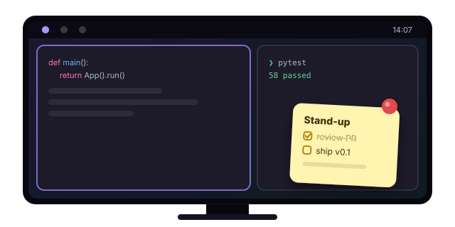

:simple-rust: Powered by Rust

Realer Xpad

Sticky notes for Linux that speak <strong>Markdown</strong> and let you <strong>doodle</strong>. Wayland-native, Hyprland-ready, and powered by Rust.

  
  
  
  
  
  
  

[Get started :material-arrow-right:](install.md){ .md-button .md-button--primary }
[:fontawesome-brands-github: View on GitHub](https://github.com/giosuel/realer-xpad){ .md-button }

$ git clone https://github.com/giosuel/realer-xpad && ./realer-xpad/install.sh

## Small notes, fewer compromises

xpad got one thing right: notes that just *sit there* on your desktop, ready for a thought. Realer Xpad keeps that and adds what was missing.

-   :material-language-markdown:{ .lg } **Live Markdown**

    ---

    Headings, **bold**, *italic*, `code`, quotes and links, styled as you type. Click away and the note switches to a clean read view.

-   :material-checkbox-marked-outline:{ .lg } **Checklists that click**

    ---

    `- [ ]` becomes a real checkbox. <kbd>Enter</kbd> continues a list and <kbd>Tab</kbd> nests it.

-   :material-draw:{ .lg } **Pen, highlighter, shapes, eraser**

    ---

    Sketch over your text with stylus pressure, lines, arrows, boxes and circles, six inks and undo. The tools are always in reach. The default ink adapts to light and dark mode.

-   :material-palette-swatch-variant:{ .lg } **Seven moods**

    ---

    Lemon, peach, rose, lavender, sky, mint and graphite, each with a hand-tuned dark variant that follows your system theme.

-   :material-pin-outline:{ .lg } **Hyprland-native**

    ---

    Notes float, return to where you left them, and pin to every workspace through Hyprland's IPC.

-   :simple-rust:{ .lg } **Powered by Rust**

    ---

    A single ~3 MB binary that starts fast and uses about a third less memory than the Python version did. Notes are still plain `.md` files you can grep.

<figure class="rx-figure" markdown>
  
  <figcaption>Notes in dark mode next to the notes manager, rendered in a pure Wayland session.</figcaption>
</figure>

## Write it plain, read it pretty

You type ordinary Markdown. Realer Xpad dims the syntax while you edit, so the structure stays visible without getting in the way. When you click away, the note switches to a clean rendered view where checkboxes and links are clickable.

Lists continue themselves, <kbd>Ctrl</kbd>+<kbd>B</kbd> and <kbd>Ctrl</kbd>+<kbd>I</kbd> wrap your selection, and code fences switch off formatting inside them.

[Writing notes :material-arrow-right:](guide/notes.md)

## Stays with you on every workspace

Pin a note and it follows you across workspaces, for that one thing you can't forget today. Notes also remember their exact position and size between sessions, because Realer Xpad asks Hyprland where you put them.

Bind `realer-xpad new` and `realer-xpad toggle` to keys and notes are always one shortcut away.

[Set up Hyprland :material-arrow-right:](hyprland.md)

## Stick a note on it

Free and open source under AGPL-3.0. Built with :simple-rust: Rust, GTK 4 and libadwaita.

[Install Realer Xpad :material-arrow-right:](install.md){ .md-button .md-button--primary }
[:fontawesome-brands-github: Star on GitHub](https://github.com/giosuel/realer-xpad){ .md-button }

